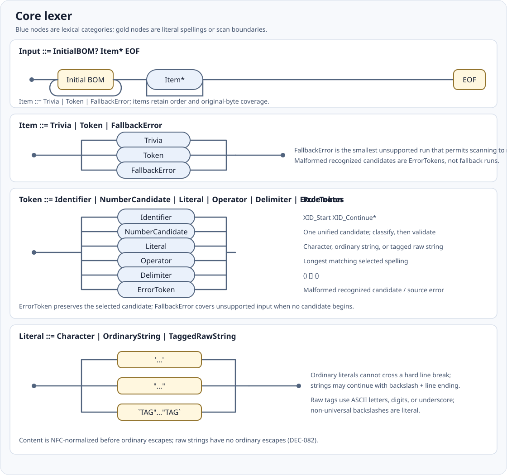
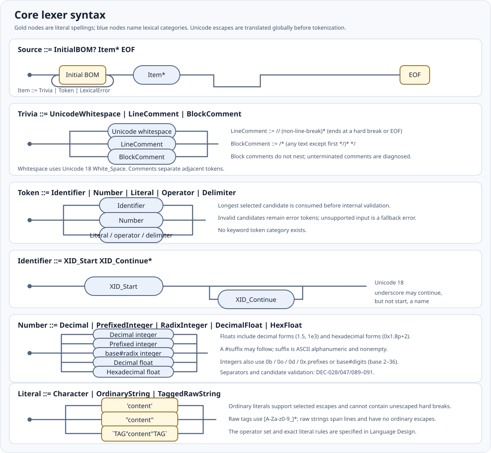
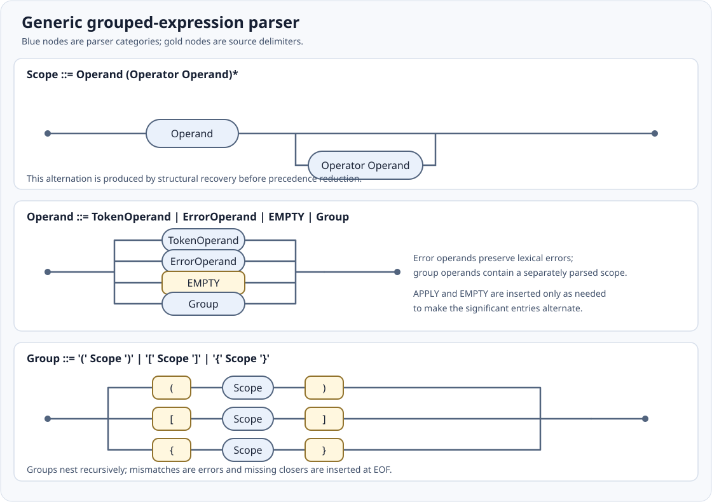
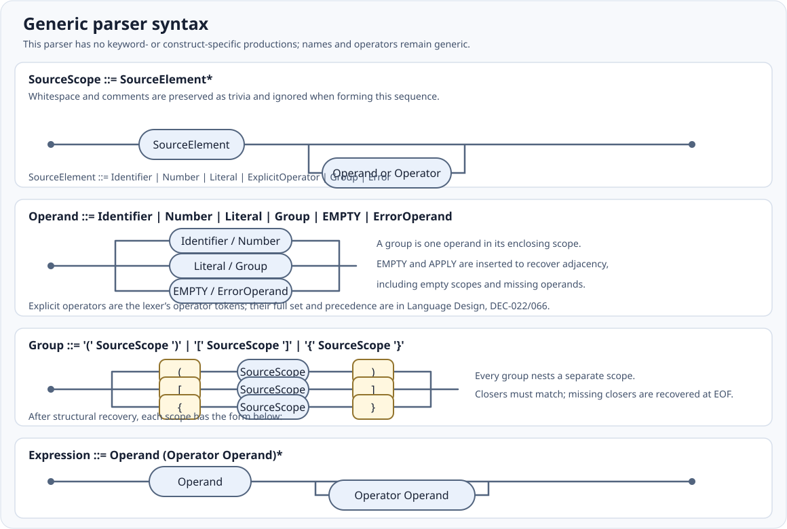

# Lexer and parser railroad diagrams

These diagrams describe the implemented core frontend, not a complete language
specification. The approved decisions in the
[Language Design](design-research/Language-Design.md) remain normative. In
particular, the parser intentionally has no keyword- or construct-specific
productions; declarations, types, and other language forms receive semantic
interpretation later.

The original diagrams below are retained as overviews of lexer items and parser
recovery/structure. The additional syntax diagrams show the token and expression
forms recognized by these passes.

## Core lexer

The source is processed before scanning: eligible `\uXXXX` and `\UXXXXXXXX`
escapes are translated globally, while original UTF-8 byte ranges are retained.
The scanner then consumes the longest selected token candidate. Numeric
candidates are classified and validated after matching; malformed candidates
keep their candidate extent rather than falling back to shorter tokens. When no
candidate starts at a position, the fallback error run is as small as possible
while allowing scanning to resume. These rules are specified by DEC-027/035,
DEC-067/071, DEC-085, and DEC-089/091.

Identifiers use Unicode 18 `XID_Start XID_Continue*`; there is no separate
keyword token category. Comments are non-nesting trivia and separate adjacent
tokens: `//` comments end at a hard line break or EOF, and `/* ... */` comments
end at the first closing marker. The initial BOM, whitespace, comments, tokens,
and fallback errors are retained in source order with original-byte spans.
Invalid recognized literals or numbers are error tokens, distinct from fallback
errors.

## Lexer syntax

The number productions summarize valid decimal, radix, prefixed, and floating
forms. Numeric candidates are deliberately matched permissively and validated
after matching; malformed candidates remain error tokens. See DEC-028/033,
DEC-047/058–061, and DEC-089–091 for exact numeric constraints. The recognized
operator spellings and literal escape forms are specified in the normative
Language Design (DEC-022/025–030, DEC-039–045, DEC-093).

The explicit operator tokens are `<<=`, `>>=`, `::=`, `++`, `--`, `**`, `<<`,
`>>`, `<=`, `>=`, `==`, `!=`, `&&`, `||`, `<-`, `->`, `:=`, `+=`, `-=`, `*=`,
`/=`, `%=`, `&=`, `|=`, `^=`, `::`, `!`, `~`, `*`, `/`, `%`, `+`, `-`, `&`,
`^`, `|`, `<`, `>`, `=`, `:`, `?`, `.`, `@`, `,`, and `;`. Overlapping
spellings use longest match.

## Generic grouped-expression parser

The scanner's tokens are structurally grouped and recovered before precedence is
applied. Comments and whitespace stay in the lossless CST but do not participate
in implicit insertion. Each scope receives only the minimal `APPLY` operators
between adjacent operands and `EMPTY` operands between adjacent operators;
empty scopes receive one `EMPTY`. Collapsed errors retain diagnostics and are
classified under DEC-092/068. Mismatched closers become errors, and missing
closers are inserted and diagnosed at EOF.

Each delimiter group is an operand whose contents form an independent scope.
The alternating sequence is then reduced to a binary CST using the approved
operator precedence and associativity table in DEC-022/066/093 (also implemented
in [`src/parser/precedence.ts`](../src/parser/precedence.ts)). Prefix and
postfix spellings use the same binary model and implicit `EMPTY`; the parser
does not check operator meanings, operand legality, or predefined identifiers.
See DEC-008/048, DEC-063/069/072/073/076, and DEC-092 for the governing choices.

## Parser syntax

The parser accepts generic operand/operator syntax rather than named language
constructs. It inserts only the minimal `APPLY` and `EMPTY` elements needed to
recover an alternating sequence, then applies the precedence and associativity
rules in DEC-022/066/093. The `Expression` production describes that normalized
sequence; malformed delimiters and lexical errors are recovered with
diagnostics, as shown in the retained parser overview. In that production,
`Operator` is an explicit operator token or an inserted `APPLY`; an
operator-classified error appears only in recovered input.
